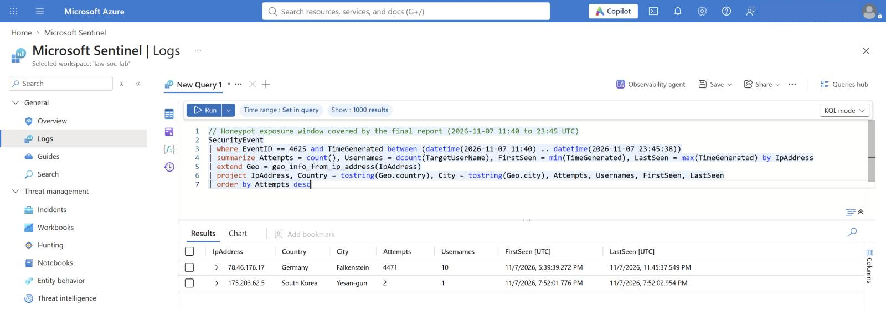
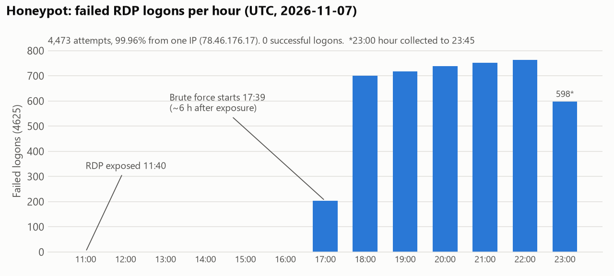
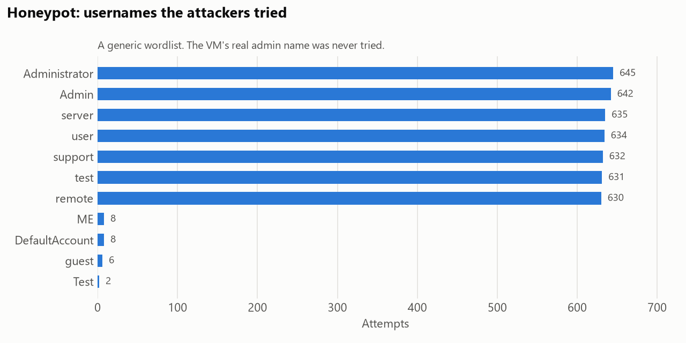
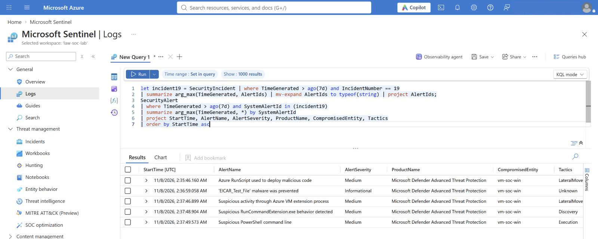
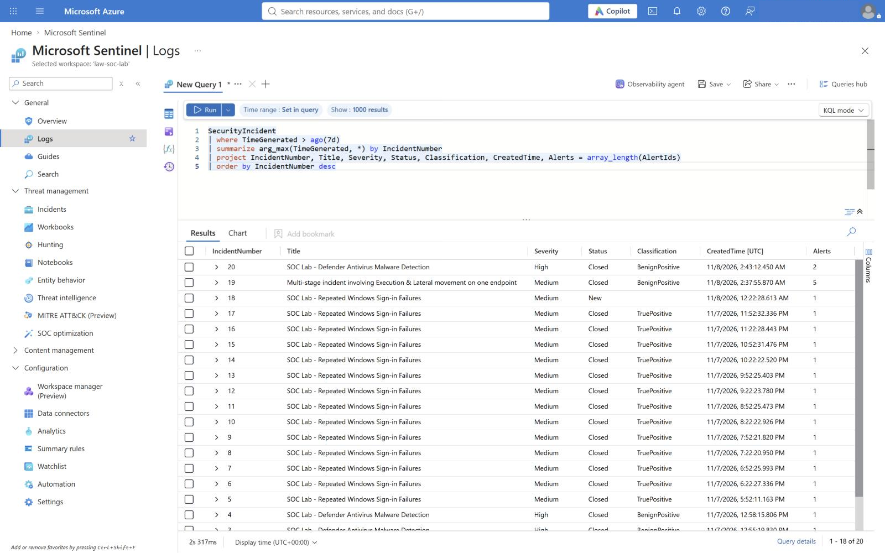
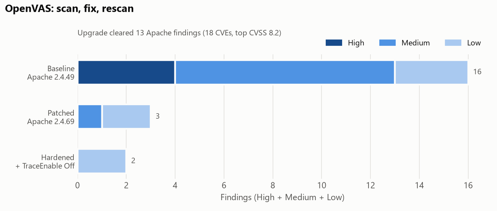

# SOC Portfolio Lab

This lab pairs Microsoft Sentinel detection and incident response (failed sign-ins, endpoint malware detections, and a real internet-facing honeypot) with a local OpenVAS vulnerability-management exercise. The Azure test VM generates its own failed sign-ins. The honeypot collected 12 hours of real attack traffic. The OpenVAS target lives on a separate internal container network.

## Start with the evidence

| Case | What the evidence shows |
|---|---|
| [Sentinel sign-in investigation](reports/INC-0001-repeated-signin-failures.md) | Six simulated failures triggered an incident. The single-failure control stayed below the threshold. |
| [Internet RDP honeypot](reports/INC-0002-honeypot-rdp-bruteforce.md) | The 23:45 UTC data cut contained 4,473 failed logons. The later timeline records 4,859 failures from the primary source alone over the full exposure. |
| [OpenVAS scan, fix, and rescan](reports/VULN-0001-apache-remediation.md) | High findings fell from 4 to 0 and medium findings from 9 to 0. Two low findings remained. |

## 1. Build the Sentinel lab

**Rebuilding the lab today.** Provision the Log Analytics workspace in Azure, then follow Microsoft's onboarding instructions to connect the Sentinel-enabled workspace to the Microsoft Defender portal. Microsoft lists **31 March 2027** as the end of Azure-portal support for Sentinel. [Defender portal onboarding](https://learn.microsoft.com/en-us/microsoft-365/security/defender/microsoft-sentinel-onboard) · [Portal support timeline](https://learn.microsoft.com/en-us/azure/sentinel/microsoft-sentinel-defender-portal)

1. Create `rg-soc-lab` in Azure for Students. Create the `law-soc-lab` Log Analytics workspace in Japan East. The subscription allows Japan East for these resources.
2. Enable Microsoft Sentinel on `law-soc-lab`. Install Microsoft's Windows Security Events solution to get the **Windows Security Events via AMA** connector.
3. Deploy a small Windows Server 2022 lab VM named `vm-soc-win` in Japan East. Give it a system-assigned identity and use Trusted Launch. For this deployment the Standard IP supplies outbound connectivity, and the network security group has no custom inbound allow rules. Run guest commands through Azure Run Command.
4. Install Azure Monitor Agent. Associate `dcr-soc-signins` with the VM. It sends successful logon events (`4624`) and failed logon events (`4625`) to the `SecurityEvent` table in `law-soc-lab`.
5. Run [the simulation script](scripts/Simulate-SigninFailures.ps1) with `-Mode Smoke` on the dedicated VM. Check that the local Windows event arrives in `SecurityEvent` before deploying a scheduled analytics rule.
6. Use [the KQL detection](detections/repeated-windows-signin-failures.kql) in a scheduled rule. Run it every five minutes over a ten-minute lookback. Create an incident when at least one account and host pair meets the threshold of five failed logons. Map it to Credential Access and MITRE ATT&CK T1110.

## 2. Investigate a simulated incident

1. Run the simulation in `Full` mode. It generates six failed logons for `soclab-probe` and one for `soclab-control`. Both are fictitious usernames, and the script checks that neither exists before testing.
2. In Sentinel, open the incident created by the rule. Compare the positive test and the negative control. Check for any successful `4624` event for the same target account around the time of the failures.
3. Record the timestamp, event IDs, impacted VM, account, evidence, and disposition. Record the response you would recommend if the same pattern appeared outside the lab. Keep the simulation label on screenshots and reports.

**Result:** Incident #1 fired for `soclab-probe` (6 failures in about 1.6 s). The `soclab-control` negative control was not alerted. Full write-up: [reports/INC-0001-repeated-signin-failures.md](reports/INC-0001-repeated-signin-failures.md).

## 3. Bring endpoint malware detections into Sentinel

The VM runs Microsoft Defender Antivirus (built into Windows Server). This step forwards the antivirus's own detection events to Sentinel. Defender for Endpoint (EDR) was added later. See "Tuning after the honeypot" below.

1. Create `dcr-soc-defender` ([detections/defender-dcr.json](detections/defender-dcr.json)). It collects only events `1116` (malware detected) and `1117` (action taken) from `Microsoft-Windows-Windows Defender/Operational` into the `Event` table. Associate it with `vm-soc-win` next to the existing sign-in DCR.
2. Add the scheduled rule ([KQL](detections/defender-antivirus-malware-detection.kql), [full definition](detections/defender-analytics-rule.json)). It is High severity, runs every 5 minutes over 10, maps a Host entity, and has custom details Threat / FilePath / Actions. Incident grouping by entity is on.
3. Wait at least 5–10 minutes after associating the DCR. Then run [scripts/Invoke-EicarTest.ps1](scripts/Invoke-EicarTest.ps1) through Run Command. It writes the harmless EICAR test file and prints Defender's detection, the quarantine result and the 1116/1117 timestamps.
4. Confirm both events reach `Event`, then investigate the incident: threat, file, process, user, other hosts, and logons around the time.

**Result:** Defender quarantined the file within 10 s. Incident #2 (High) opened 5 min 27 s after the detection. My first test, run right after the DCR was created, never reached Sentinel because the agent hadn't loaded the rule yet. The overlapping lookback created a duplicate (#3), so I enabled grouping. Saving that edit re-ran the rule and raised one more duplicate (#4). Evidence: [evidence/sentinel-defender-detection.md](evidence/sentinel-defender-detection.md). Write-up: [reports/INC-0003-defender-eicar-detection.md](reports/INC-0003-defender-eicar-detection.md).

## 4. Expose a honeypot and investigate real attacks

1. Deploy `vm-honeypot` (Windows Server 2022) in its own resource group `rg-soc-honeypot`. Use a non-default admin username and a long password, and keep NLA on. Add an NSG rule that allows RDP 3389 from any source.
2. Install Azure Monitor Agent and associate `dcr-soc-signins` (4624/4625). Add `dcr-soc-rdp` for RDP connection events: RdpCoreTS 131 (connection) and 140 (NLA bad credentials), plus TerminalServices 1149 (RDP success). Without it, scanners that never send a password are invisible.
3. Leave it exposed for 12 hours and let the existing sign-in rule raise incidents.
4. Investigate in Sentinel: source IPs and geolocation (`geo_info_from_ip_address`), usernames and failure codes, hourly timeline, and any 4624 type 3/10 or 1149 success. Confirm on the host with Run Command.
5. Tear down the resource group. The logs stay in the workspace.

**Result:** Scanners found the port in 12 minutes. Password guessing started about 6 h later. The data cut through **23:45 UTC** recorded **4,473 failed logons**: 4,471 from one German hosting IP and 2 from South Korea. Attackers tried 11 generic usernames (Administrator, Admin, server, user…) at about 12 per minute. 21 IPs connected in total. **No logon succeeded**: the real admin name was never tried, and every attempt failed at NLA. The rule raised 14 incidents for one continuous attack, with 30-minute suppression and grouping off. The honeypot was deleted on 2026-11-08 at 00:18 UTC, and the 13 incidents were closed as true positives at 00:19. The attack's last minutes raised one more incident (#18) at 00:22, *after* that closure. It sat untriaged as "New" until the final review at ~04:15 UTC spotted it (screenshot below). That review recorded 4,859 failures from the primary source alone over the full exposure. Lesson: re-check the queue after closing a batch while the rule is still running. Evidence: [evidence/honeypot-final-2347Z.md](evidence/honeypot-final-2347Z.md). Write-up: [reports/INC-0002-honeypot-rdp-bruteforce.md](reports/INC-0002-honeypot-rdp-bruteforce.md).

### Tuning after the honeypot

- **New rule:** [password spray from one source IP](detections/password-spray-by-source-ip.kql) ([definition](detections/password-spray-analytics-rule.json)). One IP with 10+ failures against 3+ accounts in 10 minutes. It maps IP and Host entities and groups incidents by IP. The historical fixed-bin backtest matched 40 of 41 active ten-minute bins for the main source. The [replay guide](backtests/README.md) includes the KQL, UTC bounds and a separately labelled synthetic run on the actual five-minute cadence. Two [regression tests](backtests/test_replay.py) verify the exact match times and window boundaries. Grouping the historical matches by IP projects one incident. The original rule raised 14 during the live lab.
- **Existing sign-in rule:** incident grouping turned on (by Host, 24 h).
- **Defender for Endpoint:** enabled through Defender for Servers Plan 1 (30-day trial). Its alerts reach Sentinel through the Defender for Cloud connector plus an incident-creation rule. With the agent onboarded, I reran EICAR and ran [Microsoft's MDE detection test](scripts/Invoke-MdeDetectionTest.ps1). MDE raised 5 alerts, from the EICAR block to "Suspicious PowerShell command line" to "Azure RunScript used to deploy malicious code", which flagged my own Run Command delivery. Sentinel merged them into one incident (#19, "Multi-stage incident involving Execution & Lateral movement") about 1 minute after the test. Both test incidents were closed as benign positives. Afterwards the plan was set back to Free and the VM deallocated.

Details: [evidence/tuning-and-mde-setup.md](evidence/tuning-and-mde-setup.md).

The portal screenshots were taken on 2026-11-08 from Sentinel → Logs, just before teardown. Microsoft has moved Sentinel's Incidents and Analytics pages to the Defender portal, so the incident list is shown through the `SecurityIncident` table instead. The account name in the portal header is blanked.

### Teardown

`rg-soc-lab` (workspace and Sentinel, both DCRs, the VM and its disk, network and extensions) was deleted on 2026-11-08 (04:20–04:23 UTC), so the lab no longer costs anything. Everything needed to rebuild it is in this repo: the KQL, rule definitions, DCR, scripts, evidence and reports.

## 5. Verify a vulnerability fix with OpenVAS

1. Run the official Greenbone Community Edition containers in the dedicated `SOC-OpenVAS` Ubuntu WSL environment. The management UI is bound to loopback. The scanner feeds and reports stay local.
2. Place the scanner and an intentionally outdated Apache HTTP Server 2.4.49 container on the `soc-openvas-targets` internal Docker network. The target exposes no host ports. Use the same target address and TCP port 80 for both scans.
3. Run the baseline scan and record which findings the scanner actually reports. Compare version-specific findings with the Apache security advisory, including CVE-2021-41773 and CVE-2021-42013 where applicable.
4. Replace the target with the current Apache 2.4 image, confirm the running version, and rescan using the same target, port list and scan configuration. Compare the reports and record any residual findings.
5. Fix the remaining configuration finding (`TraceEnable Off`) and scan once more.

Run each phase as root inside `SOC-OpenVAS` with [scripts/run-openvas.sh](scripts/run-openvas.sh) `baseline | patched | hardened`. The wrapper (re)creates the target, checks that the scanner can reach `172.31.250.10:80`, and then scans. WSL shuts the distro down when idle, which stops the target (`restart=no`). Without that check, a scan can come back nearly empty and look clean.

**Result:**

| Scan | Apache | High | Medium | Low | Total |
|---|---|---|---|---|---|
| Baseline | 2.4.49 | 4 | 9 | 3 | 28 |
| Patched | 2.4.69 | 0 | 1 (TRACE) | 2 | 15 |
| Hardened | 2.4.69 + `TraceEnable Off` | 0 | 0 | 2 | 14 |

The upgrade cleared all 13 Apache version findings (18 CVEs, top CVSS 8.2), and the config change cleared TRACE. CVE-2021-41773/42013 were not reported because the stock `Require all denied` root config blocks the active check. Full write-up: [reports/VULN-0001-apache-remediation.md](reports/VULN-0001-apache-remediation.md).

**Cleanup:** the `SOC-OpenVAS` WSL environment (about 54 GB of containers, feeds and volumes) was unregistered on 2026-11-08. The reports, evidence and scripts in this folder are all that's needed to rebuild it.

## References

- [Microsoft Sentinel Windows event connector](https://learn.microsoft.com/en-us/azure/sentinel/connect-services-windows-based)
- [Windows failed logon event 4625](https://learn.microsoft.com/windows/security/threat-protection/auditing/event-4625)
- [MITRE ATT&CK T1110 Brute Force](https://attack.mitre.org/techniques/T1110/)
- [Microsoft Defender Antivirus event IDs (1116, 1117)](https://learn.microsoft.com/defender-endpoint/troubleshoot-microsoft-defender-antivirus)
- [EICAR anti-malware test file](https://www.eicar.org/download-anti-malware-testfile/)
- [NIST incident response guidance](https://csrc.nist.gov/projects/incident-response)
- [Greenbone Community Containers](https://greenbone.github.io/docs/latest/22.4/container/)
- [Apache HTTP Server 2.4 security advisories](https://httpd.apache.org/security/vulnerabilities_24.html)
